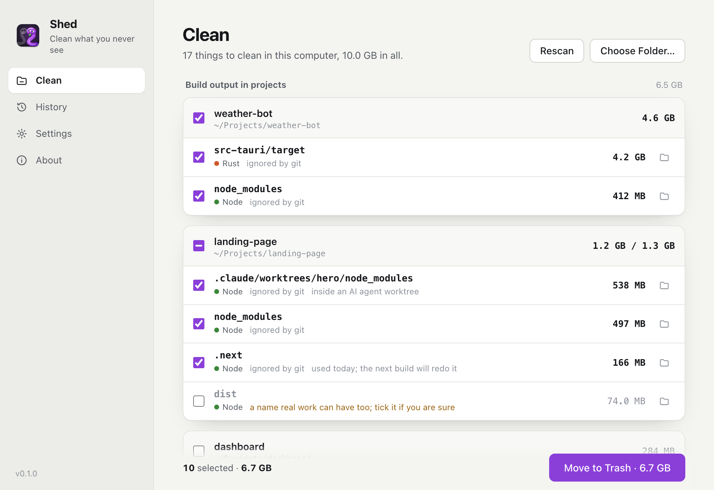
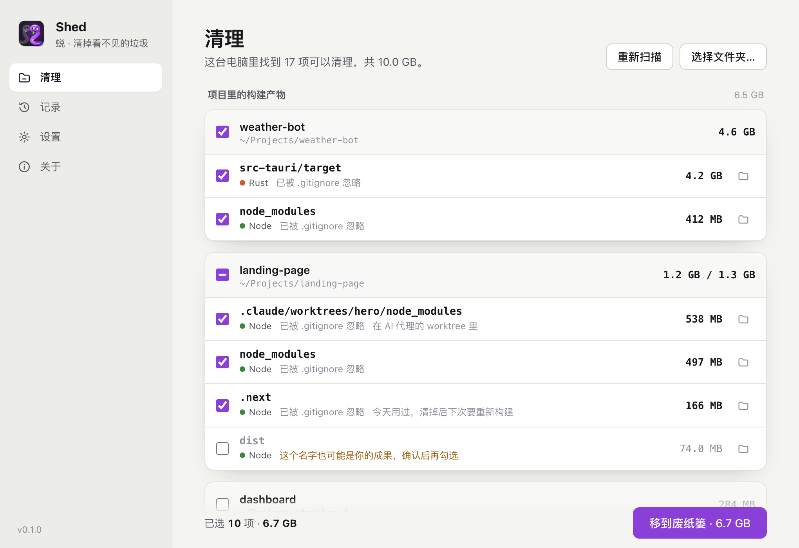

<p align="center">
  
</p>

<h1 align="center">Shed</h1>

<p align="center"><i>中文名：蜕</i></p>

<p align="center"><b>Right-click the Desktop. Get back the gigabytes your projects and AI coding agents left behind.</b><br>
Shed finds what your tools can rebuild (node_modules, Rust target, .next, Python virtualenvs, __pycache__…) across your whole computer, plus what AI coding tools leave outside your projects, shows you the list, and moves what you tick to the Trash. Offline, and every clean can be undone. For macOS and Windows.</p>

<p align="center"><a href="#中文说明">中文说明</a></p>



*Sample projects, all fictional.*

## Why

With Claude Code, Codex or Cursor, starting a project costs one sentence. Each one quietly installs its dependencies and builds: a Tauri app leaves 3–4 GB in `src-tauri/target`, a Next.js site 500 MB in `node_modules` and `.next`, an agent worktree a second copy of all of it. Measured on one Mac used this way: about 10 GB of rebuildable build output in `~/Projects` and `~/Desktop`, plus 2 GB of leftovers from the AI tools themselves (a compressed VM image kept after unpacking, old Claude Code builds, half-finished runtime downloads).

The cleaners that exist are good at parts of this but none fits the moment you think "this folder is huge":

- [Mole](https://github.com/tw93/Mole) `mo purge`, [npkill](https://github.com/voidcosmos/npkill), [kondo](https://github.com/tbillington/kondo) are terminal tools, and they delete permanently.
- They do not know what AI tools leave outside projects, and the few tools that do are macOS-only and have no right-click entry.
- Folder names alone are not proof: a `build` or `dist` folder can be the website you meant to keep.

Shed is a right-click away, looks at the whole computer, shows everything before it acts, and only uses the Trash.

## What it does

- **Right-click the Desktop.** **Clean This Mac with Shed** (Windows: **Clean This PC with Shed**) scans every project in your home folder plus the AI-tool leftovers and caches, in a few seconds. Right-click a folder for **Clean with Shed** to look at just that one. On Windows 11 the entries are under *Show more options*.
- **Always one click away.** Shed waits in the menu bar (system tray on Windows): **Clean This Computer…**, **Undo Last Clean**. Turn on **Open at login** in Settings.
- **A list first.** Everything Shed would clean, grouped by project, with sizes. Nothing moves until you press **Move to Trash**.
- **Proof, not names.** A folder only counts next to the file that proves what it is: `node_modules` beside `package.json`, `target` beside `Cargo.toml`, a virtualenv by its `pyvenv.cfg`, and about 25 project types in all (rules adapted from kondo). Projects inside projects are found too, so a Tauri app's `src-tauri/target` is not missed.
- **Git has the last word.** Anything with files git tracks is never offered. Names that can be real work (`build`, `dist`, `out`, `bin`, `vendor`…) are only ticked when git ignores them.
- **Careful by default.** A project with a dev server or watcher running is not ticked. A virtualenv without a requirements file is not ticked. Anything touched today says so.
- **AI leftovers.** The whole-computer list adds what AI coding tools leave outside projects, plus download caches (npm, pnpm, Yarn, Cargo, pip, uv, Gradle, Playwright, Homebrew…), each with what it costs to clean it.
- **Conversation history is off limits.** Codex sessions, Claude Code transcripts and Codex task folders are shown with their size, never offered for cleaning.
- **Undo.** Every clean is in History. Until you empty the Trash, **Undo** puts every folder back. It never overwrites a folder that was rebuilt in the meantime.

### What counts as an AI leftover

| Item | Where | Ticked by default |
|---|---|---|
| Compressed Claude VM image, kept after it was unpacked | `Claude/vm_bundles/claudevm.bundle/rootfs.img.zst` | No: if the VM is ever rebuilt it is downloaded again (~1 GB) |
| Old Claude Code builds the Claude app keeps after updates | `Claude/claude-code/<version>` (all but the newest and any in use) | Yes |
| Old Claude Code CLI versions | `~/.local/share/claude/versions` (all but the current one) | Yes |
| Unfinished Codex runtime downloads | `~/.cache/codex-runtimes/codex-runtime-install-*` older than an hour | Yes |
| Xcode build caches | `~/Library/Developer/Xcode/DerivedData` | Yes |
| Download caches | npm, pnpm, Yarn, Cargo, pip, uv, Gradle, Playwright, Go, Homebrew, CocoaPods | No |
| Conversation history | `~/.codex/sessions`, `~/.claude/projects`, `~/Documents/Codex` | Never cleaned |

Items that belong to the Claude app or Codex wait until that app is closed.

## Safety

- **Trash only.** Shed never deletes. On macOS it uses the system Trash and remembers where each folder went; on Windows the Recycle Bin.
- **Checked twice.** Right before a folder is moved, Shed checks again that it is still a real folder (not a link), still next to its project file, and still holds nothing git tracks.
- **Won't scan the system.** System folders, parent folders of your home, and `~/Library` / `AppData` are refused; hidden tool folders in your home (`~/.vscode`, `~/.claude/plugins`…) are skipped, because the tools installed there need their `node_modules`.
- **No network, no telemetry, no account.**

## Install

Download the latest installer from [Releases](../../releases).

- **macOS 11+:** download `_aarch64.dmg` (Apple silicon) or `_x64.dmg` (Intel) and drag Shed to Applications. The app is not notarized yet, so the first launch is blocked once: open **System Settings → Privacy & Security** and click **Open Anyway**. Opening Shed once turns on its Finder extension, which adds the right-click entries. You can switch it off in Shed's Settings or under **System Settings → General → Login Items & Extensions → Finder**. macOS asks once per folder (Desktop, Documents, Downloads) before Shed may look inside.
- **Windows 10/11:** run the `-setup.exe` (adds the Explorer entries right away) or the `.msi` (adds them the first time Shed opens). If SmartScreen appears, click **More info → Run anyway**.

## Command line

The app binary is also a CLI, so an agent can clean up after itself:

```bash
shed scan ~                        # the whole home folder; change nothing
shed scan ~/Projects               # or one folder
shed clean ~/Projects --apply      # move the ticked items to the Trash
shed leftovers                     # AI tool leftovers, caches, history sizes
shed undo                          # put the last clean back
```

On macOS the binary is at `/Applications/Shed.app/Contents/MacOS/shed`.

## Limits

- Moving to the Trash does not free space by itself; empty the Trash when you are sure.
- Where AI tools keep their files is not documented and may change. Shed only offers locations it recognizes exactly, and never anything it cannot explain.
- Anyone can open a `shed://computer` link and start a scan. A scan only reads; nothing moves without your click.
- On Windows, a folder too large for the Recycle Bin may be deleted for good instead of recycled; Windows decides this. The Windows build is unit-tested in CI but has not been tried on a real Windows machine yet.
- Rebuilding takes time: the next `npm install` or `cargo build` after a clean is a full one.

## Build from source

Requirements: [Rust](https://rustup.rs), Node.js 18+, and on macOS the Xcode Command Line Tools.

```bash
npm install
npm run dev        # run the app
npm run build      # build installers into src-tauri/target/release/bundle
cd src-tauri && cargo test
```

The UI is plain HTML, CSS and JS in `ui/` with no build step. Open `ui/index.html` in a browser to work on it: `ui/preview-mock.js` fakes the backend with sample data.

## Credits

The table of project types and their rebuildable folders started from [kondo](https://github.com/tbillington/kondo) by Trent Billington (MIT).

## License

[MIT](LICENSE)

---

## 中文说明

**蜕（Shed）：在桌面右键一下，把项目和 AI 编程工具留下、你从来看不见的几个 GB 拿回来。**



*示例项目，均为虚构。*

用 Claude Code、Codex、Cursor 开发，开一个项目只要一句话，而每个项目都会悄悄装依赖、做构建：一个 Tauri 应用的 `src-tauri/target` 有 3–4 GB，一个 Next.js 网站的 `node_modules` 加 `.next` 有 500 MB，代理开的 worktree 里还会再来一份。在一台这样用的 Mac 上实测：`~/Projects` 和 `~/Desktop` 里能重新生成的构建产物约 10 GB，AI 工具自己在项目之外还留了约 2 GB（解压后没删的虚拟机压缩包、旧版 Claude Code、下载到一半的运行时）。

现有工具各管一块，但都不适合「这个文件夹怎么这么大」的那一刻：Mole、npkill、kondo 要在终端里用，而且直接永久删除；它们不知道 AI 工具在项目之外留下了什么；少数知道的又只支持 macOS，也没有右键入口；而且只看名字不可靠，`build`、`dist` 可能正是你要留的网站。

蜕的做法：

- **在桌面空白处右键**：「用 Shed 清理这台电脑」，几秒钟扫完用户文件夹里的所有项目，加上 AI 工具遗留和下载缓存。右键某个文件夹则是「用 Shed 清理」，只看这一个。Windows 11 在「显示更多选项」里。
- **随时一键**：Shed 常驻菜单栏（Windows 在系统托盘），菜单里有「清理整台电脑」「撤销上一次清理」。设置里可以打开「开机自动启动」。
- **先列清单**：按项目分组，列出能清理的东西和大小。点「移到废纸篓」之前什么都不会动。
- **要有证据，不只看名字**：旁边有 `package.json` 才算 `node_modules`，旁边有 `Cargo.toml` 才算 `target`，有 `pyvenv.cfg` 才算虚拟环境，一共约 25 种项目类型（规则参考 kondo）。项目里套着的项目也能找到，比如 Tauri 应用的 `src-tauri/target`。
- **git 说了算**：有 git 跟踪文件的文件夹永远不会列为可清理。`build`、`dist`、`out`、`bin`、`vendor` 这类也可能是成果的名字，只有被 git 忽略时才默认勾选。
- **默认谨慎**：项目里有开发服务器或监视程序在跑，不勾；虚拟环境找不到依赖清单，不勾；今天刚用过的，会标出来。
- **AI 遗留**：清理整台电脑时，清单里还会列出 AI 编程工具在项目之外留下的东西和各种下载缓存（npm、pnpm、Yarn、Cargo、pip、uv、Gradle、Playwright、Homebrew 等），每项写明清掉的代价。属于 Claude 桌面版或 Codex 的项目，要等它们退出后才能清。
- **对话记录不碰**：Codex 会话、Claude Code 会话记录、Codex 任务文件夹（文稿/Codex）只显示占用，永远不会列为可清理。
- **可以撤销**：每次清理都记在「记录」里。清空废纸篓之前，「撤销」能把文件夹全部放回原处；如果原位置已经重新生成了同名文件夹，不会覆盖它。

**安全**：只移到废纸篓，从不直接删除；移动前的一刻会再检查一遍（仍然是真实文件夹、旁边仍有项目文件、git 仍未跟踪）；不扫描系统文件夹、主目录的上层、`~/Library` 和 `AppData`，也会跳过主目录下工具的隐藏安装目录（比如 `~/.vscode`、`~/.claude/plugins`，那里的 `node_modules` 是工具运行要用的）；不联网，没有统计，没有账号。

**安装**：到 [Releases](../../releases) 下载。macOS 选 `_aarch64.dmg`（Apple 芯片）或 `_x64.dmg`（Intel），拖进「应用程序」。应用还没有经过苹果公证，第一次打开会被拦一次：到 系统设置 → 隐私与安全性，点「仍要打开」。打开过一次之后，Shed 的访达扩展就会启用，右键菜单随之出现；可以在 Shed 的设置里关掉，也可以在 系统设置 → 通用 → 登录项与扩展 → 访达 里管理。第一次看桌面、文稿、下载文件夹时，macOS 会各问一次是否允许。Windows 运行 `-setup.exe`（安装时就加好右键菜单）或 `.msi`（第一次打开 Shed 时加好）；如果出现 SmartScreen，点「更多信息 → 仍要运行」。

**限制**：移到废纸篓本身不释放空间，确认后清空废纸篓才行；AI 工具存放文件的位置没有官方文档，以后可能会变，Shed 只处理能准确认出的位置；Windows 上太大、放不进回收站的文件夹可能被系统直接删除；Windows 版在 CI 里跑过单元测试，但还没在真机上试过；清理之后下一次 `npm install` 或 `cargo build` 会是完整的一次。

**命令行**：`shed scan ~` 扫描整个用户文件夹，`shed scan <文件夹>` 只列清单，`shed clean <文件夹> --apply` 移到废纸篓，`shed leftovers` 查看 AI 遗留，`shed undo` 撤销上一次。
